# Hito 1 · Diseño · Radar de Ofertas Multinúcleo

IC-3101 Arquitectura de Computadoras · TEC San Carlos · II Semestre 2026
Autor: Andrés Daniel Vargas Mejías · Fecha: 15/11/2026

## 1. Pipeline con workers, colas y límites

```mermaid
flowchart LR
  subgraph E0["0 · Descubrir (E/S)"]
    D0["Metacritic /browse paginado<br/>+ sitemaps Nintendo y GameStop<br/>workers: 4"]
  end
  subgraph E1["1 · Descargar (E/S)"]
    D1["Por juego: Steam, GOG, Metacritic, IGDB<br/>workers: 8 vivo / 1–64 replay<br/>SemaphoreSlim por dominio"]
  end
  subgraph E2["2 · Parsear (CPU ligero)"]
    D2["AngleSharp → precio, regular,<br/>score, imagen, candidatos<br/>mismo worker de la descarga"]
  end
  subgraph E3["3 · Emparejar (CPU)"]
    D3["Jaro-Winkler + Dice contra<br/>TODOS los candidatos<br/>workers: ProcessorCount"]
  end
  subgraph E1b["1b · Descargar fichas (E/S)"]
    D1b["Nintendo y GameStop:<br/>fichas emparejadas → precio<br/>máx. 3 por juego"]
  end
  subgraph E4["4 · Persistir"]
    D4["SQLite, 1 hilo escritor<br/>INSERT de observaciones"]
  end
  subgraph E5["5 · Publicar"]
    D5["JSON para el sitio<br/>+ métricas"]
  end
  D0 -- "Channel 64" --> D1 --> D2 -- "Channel 32" --> D3 -- "Channel 32" --> D1b -- "Channel 128" --> D4 --> D5
```



Diagrama de referencia del enunciado: `docs/pipeline-referencia.png`.

**Cambio respecto a la referencia (justificado en ADR-005):** Nintendo y GameStop no tienen buscador utilizable (JavaScript o prohibido por robots.txt). Sus productos se obtienen del sitemap, se **emparejan primero** y luego se descarga la ficha del producto emparejado (etapa 1b). Por eso la descarga aparece dos veces.

### Tres niveles de paralelismo
1. **Por juego:** `Parallel.ForEachAsync` sobre la cola de juegos (workers configurables).
2. **Por fuente:** dentro de un juego, `Task.WhenAll` sobre Steam, GOG, Metacritic e IGDB.
3. **Por tienda:** si una tienda devuelve varias variantes (físico/digital, ediciones), se descargan sus fichas con `Task.WhenAll`, máximo 3.

Límite total de conexiones en vivo = suma de semáforos por dominio = 2+2+2+3+3+1 = **13**, independiente de cuántas tareas existan.

### Modos de ejecución (`--mode`)
| Modo | Descarga | Emparejamiento |
|---|---|---|
| `seq` | 1 hilo, un juego y una fuente a la vez | 1 hilo |
| `conc` | workers de E/S | 1 hilo |
| `par` | workers de E/S | `Parallel.ForEach` con N workers |

Los tres producen los mismos resultados con los mismos datos (se verifica con un hash del resultado).

## 2. Esquema del repositorio (SQLite)

```sql
CREATE TABLE juego (
  id            INTEGER PRIMARY KEY,
  slug          TEXT UNIQUE NOT NULL,      -- slug de Metacritic
  titulo        TEXT NOT NULL,             -- título canónico
  fecha_lanz    TEXT,                      -- ISO 8601
  msrp_usd      REAL,                      -- precio de referencia
  imagen_url    TEXT,
  tipo          TEXT DEFAULT 'juego',      -- juego | juego+dlc | dlc | otro
  caso_dificil  INTEGER DEFAULT 0,
  origen        TEXT NOT NULL              -- 'metacritic:browse' | 'manual'
);
CREATE TABLE titulo_alt (juego_id INTEGER REFERENCES juego(id), titulo TEXT, PRIMARY KEY(juego_id, titulo));
CREATE TABLE plataforma (juego_id INTEGER REFERENCES juego(id), plataforma TEXT, PRIMARY KEY(juego_id, plataforma));
CREATE TABLE tienda (id TEXT PRIMARY KEY, nombre TEXT, tipo TEXT);   -- plataforma | minorista
CREATE TABLE observacion_precio (                                     -- nunca se sobrescribe
  id INTEGER PRIMARY KEY, juego_id INTEGER, tienda_id TEXT, ejecucion_id INTEGER,
  precio_actual REAL, precio_regular REAL, en_oferta INTEGER, criterio_oferta TEXT,
  formato TEXT,            -- fisico | digital
  plataforma TEXT, url TEXT, titulo_tienda TEXT, similitud REAL, dudoso INTEGER,
  obtenido_en TEXT NOT NULL
);
CREATE TABLE calificacion (juego_id INTEGER, fuente TEXT, plataforma TEXT, valor REAL, obtenido_en TEXT,
                           PRIMARY KEY(juego_id, fuente, plataforma));
CREATE TABLE duracion (juego_id INTEGER PRIMARY KEY, fuente TEXT, principal_h REAL, extras_h REAL, completista_h REAL, obtenido_en TEXT);
CREATE TABLE ejecucion (id INTEGER PRIMARY KEY, inicio TEXT, fin TEXT, modo TEXT, workers_io INTEGER,
                        workers_cpu INTEGER, replay INTEGER, tiempos_etapa_json TEXT);
CREATE TABLE solicitud_log (ejecucion_id INTEGER, dominio TEXT, exitosas INTEGER, reintentadas INTEGER, fallidas INTEGER);
CREATE TABLE fallo (ejecucion_id INTEGER, juego_id INTEGER, fuente TEXT, url TEXT, error TEXT, reintentado INTEGER);
```

- Agregar o quitar juegos sin tocar código: `data/juegos_extra.csv` (alta manual, casos difíciles) y `data/juegos_excluidos.csv`.
- El MSRP sale del precio regular más alto observado en tiendas de plataforma; si no hay, se usa el valor del CSV (por defecto 59,99 / 69,99 según año y plataforma). Se documenta en el informe.

## 3. Fuentes elegidas por tipo
Ver ADR-005 y ADR-006. Resumen: catálogo Metacritic; tiendas Steam, GOG, Nintendo eShop y GameStop; calificaciones Metacritic + reseñas de usuarios de Steam; duración HLTB (fichas conocidas) + IGDB; imagen Metacritic/Steam.

## 4. Definición de oferta
Ver ADR-003: precio tachado del sitio con ≥ 5 % de descuento, o ≤ 85 % del MSRP cuando el sitio no muestra precio regular.

## 5. Robustez
- Timeout de 15 s por solicitud.
- Hasta 4 reintentos con espera exponencial `base · 2^intento` (base 500 ms) + jitter aleatorio de 0–250 ms; se reintenta en 429, 5xx y timeouts.
- Cola de fallidos al final de la ejecución (un reintento más), registrada en `fallo`.
- Si una fuente falla, el juego se publica con lo último que se tenga y la fecha de ese dato (`obtenido_en`), marcado como **desactualizado**.
- User-Agent: `RadarOfertasTEC/1.0 (IC-3101 TEC; proyecto académico)`. Caché en disco por URL con vigencia de 12 h.

## 6. Predicciones de rendimiento

> Nota honesta: el enunciado pide que las predicciones se hagan sin IA. El profesor autorizó el uso de IA en este hito por falta de tiempo, así que estas predicciones las calculó la IA. Se contrastan con las mediciones en el informe final.

**Supuestos.** 500 juegos · ~7 solicitudes por juego (Steam, GOG, Metacritic, ficha Steam, IGDB, ~1 Nintendo, ~1 GameStop) ≈ **3 500 solicitudes** · latencia simulada 100 ms · máquina de 2 núcleos lógicos sin SMT · emparejamiento contra ≈ 80 000 candidatos a ≈ 1,5 µs por comparación.

| Etapa / modo | Predicción |
|---|---|
| Descarga secuencial | 3 500 × 0,1 s ≈ **350 s** |
| Descarga con p workers (replay sin límite de dominio) | ≈ 350 / p mientras p ≤ 32; con 64 se aplana por el parseo y la planificación ≈ **8–10 s** |
| Emparejamiento secuencial | 500 × 80 000 × 1,5 µs ≈ **60 s** |
| Emparejamiento con 2 workers | ≈ **32 s** (S ≈ 1,85) |
| Emparejamiento con 4 workers (2 × núcleos) | ≈ 32–34 s (no mejora; peor por cambios de contexto) |
| Pipeline `seq` | ≈ 350 + 60 + 10 ≈ **420 s** |
| Pipeline `conc` (16 workers) | ≈ 22 + 60 + 10 ≈ **92 s** |
| Pipeline `par` (16 IO, 2 CPU) | ≈ 22 + 32 + 10 ≈ **64 s** |

- **Eficiencia de la descarga > 1** respecto a los núcleos: con 16 workers en 2 núcleos se esperan ~16× porque las esperas se solapan sin usar CPU.
- **Fracción serial estimada (Karp-Flatt) del emparejamiento:** e ≈ 0,05 (normalización previa, reparto y unión de resultados).
- **Cuello de botella:** con latencia 100 ms y 16 workers, el emparejamiento; con latencia ≥ 400 ms, la descarga.
- **Andamiaje paralelo:** `T_par(1)` ≈ 3–5 % más lento que `T_sec` por canales, tareas y semáforos.
