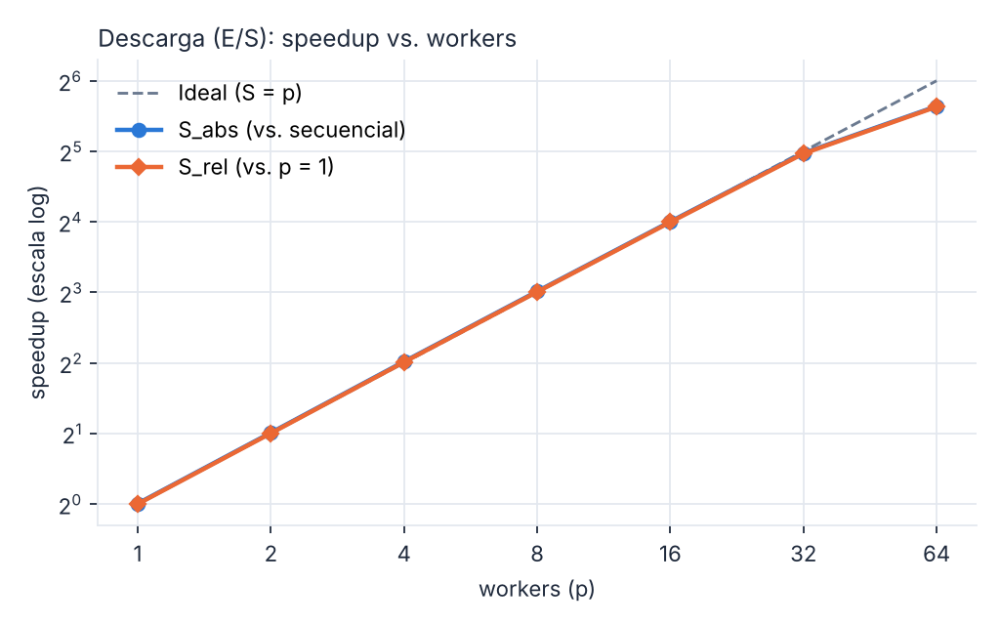
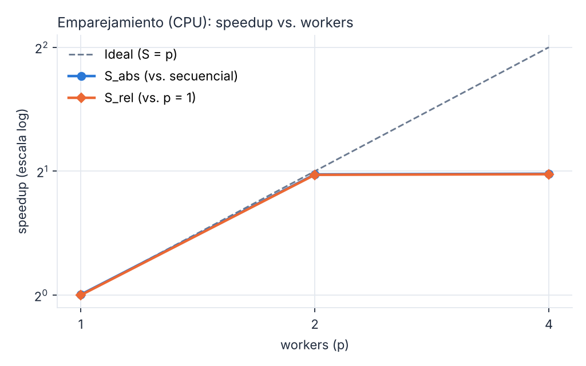
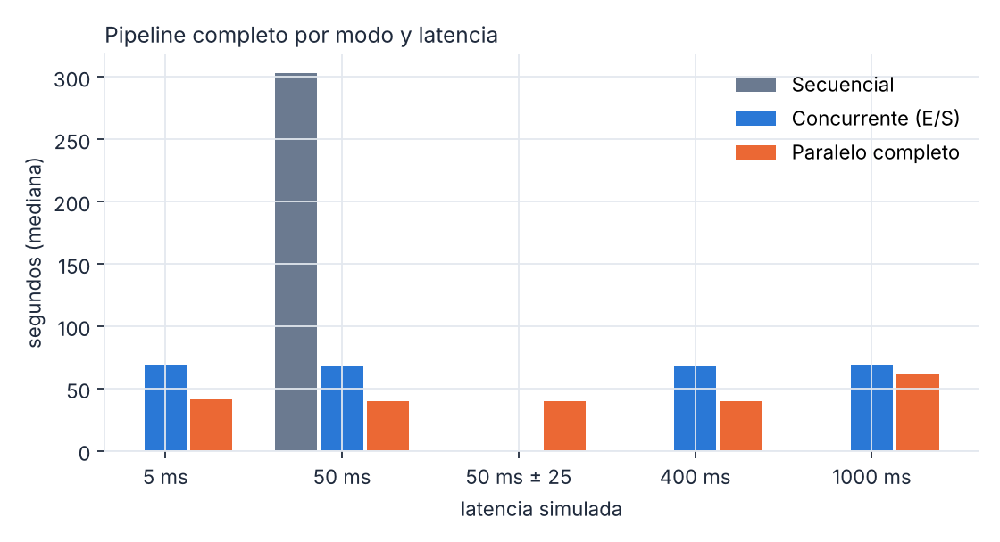

# Informe técnico · Radar de Ofertas Multinúcleo

**IC-3101 Arquitectura de Computadoras** · Instituto Tecnológico de Costa Rica, Campus San Carlos · II Semestre 2026
**Integrantes:** Andrés Daniel Vargas Mejías _(+ compañeros por agregar)_
**Fecha:** 15/11/2026

---

## 1. Resumen

Construimos un sitio público de ofertas de videojuegos alimentado por un pipeline de web scraping en C# (.NET 8) con **tres modos de ejecución del mismo código**: secuencial, concurrente (solo la E/S en paralelo) y paralelo completo (E/S + emparejamiento repartido entre núcleos). El catálogo tiene **955 juegos** y se publican **666** con precio en 2 tiendas o más (Steam, GOG, Nintendo eShop y GameStop).

Medimos todo en **modo replay** (respuestas reales capturadas, latencia simulada) sobre una máquina de 2 núcleos. Resultados principales:

| Medición | Resultado |
|---|---|
| Pipeline completo, latencia 50 ms | Secuencial **303 s** → concurrente **67,8 s** (4,47×) → paralelo **40,3 s** (**7,53×**) |
| Descarga (E/S) con 64 workers | **49,8×** más rápida que la secuencial, con solo 2 núcleos |
| Emparejamiento (CPU) con 2 workers | **1,97×**; con 4 workers no mejora (hay 2 núcleos) |
| Fracción serial (Karp–Flatt) del emparejamiento | **e ≈ 0,021** |
| Emparejamiento validado (200 pares revisados) | Precisión **0,986**, exhaustividad **0,986** con umbral 0,88 |
| Resultado igual en los tres modos | Sí: el mismo hash del resultado en las 50 corridas del pipeline |

## 2. Ficha del equipo de medición

| Dato | Valor |
|---|---|
| Procesador | Intel Xeon @ 2,10 GHz (máquina virtual en la nube) |
| Núcleos físicos / lógicos | 2 / 2 |
| SMT | No (1 hilo por núcleo) |
| Memoria | 7,8 GB |
| Sistema operativo | Ubuntu 24.04.5 LTS |
| Lenguaje | C# · .NET 8.0.34 · compilación Release |

> Limitación: con 2 núcleos el speedup de cálculo no puede pasar de ~2, y no se puede medir el efecto de SMT. Las conclusiones sobre SMT son teóricas (pregunta 4).

## 3. Arquitectura

Pipeline de etapas conectadas por `Channel<T>` acotados (detalle en `docs/hito1-diseno.md` y ADR-004, 010, 012):

```
0 Descubrir ─▶ 1 Descargar (E/S) + 2 Parsear ─▶ 3 Emparejar (CPU) ─▶ 1b Fichas (E/S) ─▶ 4 Persistir ─▶ 5 Publicar
   Metacritic      Steam, GOG, Metacritic          Jaro-Winkler +        Nintendo y         SQLite,       JSON para
   + sitemaps      (Task.WhenAll por juego)        Dice, 47 432 cand.     GameStop           1 hilo        el sitio
                   cola 64 → 32                    cola 32                cola 128
```

- **Nivel 1 (por juego):** `Parallel.ForEachAsync` con `p` workers de E/S.
- **Nivel 2 (por fuente):** `Task.WhenAll` sobre las fuentes de un juego.
- **Nivel 3 (por tienda):** `Task.WhenAll` sobre las variantes (plataforma/formato), máximo 3.
- **Control:** `SemaphoreSlim` por dominio (2–3 conexiones en vivo), intervalo mínimo de 1,5 s para Steam, colas acotadas con contrapresión.
- **Robustez:** timeout 15 s, 4 reintentos con backoff exponencial + jitter, cola de fallidos al final, datos viejos marcados en el sitio con la fecha del último dato bueno.

**Determinismo:** los tres modos producen exactamente el mismo resultado. El banco de pruebas lo verifica con un hash de los emparejamientos y precios en cada corrida.

## 4. Metodología

- **Modo replay:** las 4 400 respuestas reales (HTML y JSON) se capturaron el 15/11/2026 y se sirven con un `HttpMessageHandler` propio. La latencia simulada usa `Task.Delay`, igual que la red real, que no ocupa hilos. El código del pipeline es el mismo en vivo y en replay.
- **Repeticiones:** 5 por configuración. Se reporta la mediana, el mínimo, el máximo y la desviación estándar.
- **Barridos:** descarga con p = 1, 2, 4, 8, 16, 32, 64; emparejamiento con p = 1, 2 (= núcleos lógicos) y 4 (= 2 × lógicos).
- **Etapas por separado:** la descarga se mide como 2 865 solicitudes planas (955 juegos × 3 fuentes) con `p` workers. El emparejamiento se mide con las fichas ya descargadas. El pipeline completo se mide en los tres modos y con latencias de 5, 50, 400 y 1 000 ms (más una variante de 50 ± 25 ms).
- **Métricas:** S_abs = T_sec / T_par(p); S_rel = T_par(1) / T_par(p); E = S_rel / p; Karp–Flatt e = (1/S_rel − 1/p) / (1 − 1/p).
- **Reproducir:** `dotnet run --project src/Radar.Bench -c Release -- todo` y `python scripts/graficos.py`.

## 5. Resultados

Tablas completas (Anexo 2) en [`tablas-resultados.md`](tablas-resultados.md); datos crudos en `data/bench/resultados.json`.

### 5.1 Descarga (E/S), latencia 50 ms



| p | Mediana (s) | S_abs | S_rel | E(p) | e (K–F) |
|---|---|---|---|---|---|
| Secuencial | 153,13 | 1,00 | — | — | — |
| 1 | 152,30 | 1,01 | 1,00 | 1,00 | — |
| 2 | 76,00 | 2,01 | 2,00 | 1,00 | −0,002 |
| 4 | 37,78 | 4,05 | 4,03 | 1,01 | −0,003 |
| 8 | 18,95 | 8,08 | 8,04 | 1,00 | −0,001 |
| 16 | 9,55 | 16,04 | 15,95 | 1,00 | 0,000 |
| 32 | 4,87 | 31,46 | 31,29 | 0,98 | 0,001 |
| 64 | 3,07 | 49,82 | 49,55 | 0,77 | 0,005 |

### 5.2 Emparejamiento (CPU)

955 juegos × (47 432 candidatos de sitemaps + los de Steam y GOG de cada juego).



| p | Mediana (s) | S_abs | S_rel | E(p) | e (K–F) |
|---|---|---|---|---|---|
| Secuencial | 63,67 | 1,00 | — | — | — |
| 1 | 63,49 | 1,00 | 1,00 | 1,00 | — |
| 2 | 32,40 | 1,97 | 1,96 | 0,98 | 0,021 |
| 4 | 32,29 | 1,97 | 1,97 | 0,49 | 0,345 |

Comparación de mecanismos (extra): la misma etapa con **PLINQ** dio 64,33 s (p = 1), 32,48 s (p = 2) y 32,78 s (p = 4). Es prácticamente igual a `Parallel.ForEach`, porque los dos usan el mismo `ThreadPool` y la etapa no tiene estado compartido.

### 5.3 Pipeline completo



| Latencia | Secuencial | Concurrente | Paralelo |
|---|---|---|---|
| 5 ms | — | 69,46 s | 41,06 s |
| 50 ms | **303,05 s** | **67,76 s** (4,47×) | **40,25 s** (7,53×) |
| 50 ± 25 ms | — | — | 39,92 s |
| 400 ms | — | 68,08 s | 40,18 s |
| 1 000 ms | — | 68,94 s | 61,97 s |

(Concurrente y paralelo con 16 workers de E/S; paralelo con 2 workers de CPU. La dispersión máxima fue de 1,4 s.)

### 5.4 Experimento de contención

Conteo de ofertas por plataforma, repetido hasta 4 000 000 de elementos (mediana de 5, en ms):

| Mecanismo | p = 1 | p = 2 | p = 4 |
|---|---|---|---|
| Lock global | 158,8 | 99,8 | 309,9 |
| Estado local por hilo + combinar al final | 15,4 | **8,2** | 12,7 |
| `ConcurrentDictionary.AddOrUpdate` | 184,6 | 541,4 | 523,1 |
| Secuencial simple (referencia) | 3,3 | | |

- **Estado local por hilo** es el único que escala: cada hilo cuenta en su propio arreglo y solo se sincroniza una vez al final.
- **Lock global**: con 4 hilos en 2 núcleos es 2× más lento que con 1, porque los hilos se turnan el mismo candado y pagan cambios de contexto.
- **`ConcurrentDictionary`** es el peor: hay solo 7 claves, así que todos los hilos actualizan las mismas entradas y `AddOrUpdate` reintenta una y otra vez (contención fina).
- Ninguno le gana al secuencial simple (3,3 ms): el trabajo por elemento (un incremento) es tan pequeño que cualquier sincronización cuesta más que el trabajo. Paralelizar solo conviene cuando el trabajo por elemento es grande comparado con el costo de coordinar.

**Condición de carrera reproducida.** El mismo conteo con `c[x]++` sin sincronización y 2 hilos perdió entre **401 846 y 675 112** de 4 000 000 incrementos en 5 intentos, y cada intento dio un resultado distinto. `c[x]++` son tres pasos (leer, sumar 1, escribir). Si dos hilos leen el mismo valor antes de que el otro escriba, uno de los dos incrementos se pierde. Con `Interlocked.Increment` el resultado fue siempre 4 000 000.

### 5.5 Validación del emparejamiento

200 pares (juego, título en la tienda) de los 56 casos difíciles y 15 juegos al azar: 143 positivos y 57 negativos (`data/validacion_pares.csv`).

| Umbral | Precisión | Exhaustividad | F1 |
|---|---|---|---|
| 0,80 | 0,899 | 0,993 | 0,944 |
| 0,85 | 0,910 | 0,993 | 0,950 |
| 0,87 | 0,946 | 0,986 | 0,966 |
| **0,88** | **0,986** | **0,986** | **0,986** |
| 0,91 | 0,993 | 0,979 | 0,986 |
| 0,94 | 0,993 | 0,972 | 0,982 |

Se mantiene el umbral **0,88** (mejor F1). Los 4 errores que quedan:
- *Final Fantasy VII Rebirth* vs. "FINAL FANTASY VII" (0,901): mismo número, título más corto.
- *Tekken 8* vs. "TEKKEN 8 - Bob" (0,880): un DLC de personaje.
- *Resident Evil 2* (remake) vs. "Resident Evil 2" de GOG, que es el original de 1998 con el mismo nombre exacto.
- Dos verdaderos positivos rechazados: "Street Fighter 6 Years 1-2 Fighters Edition" (el "1 2" parece número de secuela) y "Nier Automata The End of YoRHa Edition".

Durante la validación se encontró que "Resident Evil 4 (2005)" se emparejaba con el remake de 2023. Por eso se agregó la regla **año distinto** (ver `cambios-diseno.md`). Los casos dudosos se muestran en el panel de métricas y no se usan para comparar precios.

## 6. Respuestas a las preguntas del enunciado

### 1. ¿Por qué la descarga sigue mejorando con más workers que núcleos, y el emparejamiento no? ¿Qué significa que la eficiencia por núcleo de la descarga supere 1?

Un worker de descarga pasa casi todo su tiempo **esperando la red** (50 ms por solicitud contra unos 0,3 ms de CPU para parsearla). Mientras espera no usa el núcleo, y con `async/await` ni siquiera ocupa un hilo. Por eso 64 workers en 2 núcleos dan 49,8×: son 64 esperas solapadas, no 64 cálculos. El emparejamiento, en cambio, es cálculo puro. Con 2 núcleos solo 2 hilos avanzan a la vez, y pasar de 2 a 4 workers no cambia nada (32,40 s → 32,29 s).

Que la eficiencia **por núcleo** supere 1 (S_abs / núcleos = 49,8 / 2 ≈ **24,9** con p = 64) significa que la ganancia no viene del hardware sino de la **concurrencia**: el recurso que se reparte es el tiempo de espera, no la CPU. Cerca de p = 64 la eficiencia por worker baja a 0,77 porque el costo fijo (parseo, creación de tareas y el `Task.Delay`) empieza a pesar contra 3 s totales.

### 2. ¿Qué etapa es el cuello de botella del pipeline y cómo cambia al variar la latencia?

Con latencias de 5 a 400 ms el cuello de botella es el **emparejamiento**:
- En modo concurrente (emparejamiento en 1 hilo) el pipeline tarda **~68 s con cualquier latencia** (69,5 / 67,8 / 68,1 / 68,9 s), casi igual que el emparejamiento solo (63,7 s).
- En modo paralelo baja a **~40 s** (≈ 32 s de emparejar con 2 núcleos + llenado y vaciado de las colas).

Como en un procesador segmentado, el throughput lo fija la etapa más lenta, y acelerar las otras no sirve.

Con **1 000 ms** el cuello de botella cambia a la **descarga**: 955 juegos / 16 workers × ~1 s ≈ 60 s supera los 32 s del emparejamiento, y el modo paralelo sube a **62,0 s**. El modo concurrente casi no cambia (68,9 s) porque ahí las dos etapas están empatadas. Para esa latencia, el arreglo es subir los workers de E/S, no los de CPU.

### 3. ¿Cuál es la fracción serial estimada y de dónde proviene?

Karp–Flatt da **e ≈ 0,021** para el emparejamiento con p = 2 (2,1 %). En el código viene de:
1. el reparto y la unión de `Parallel.ForEach` (particionar 955 juegos y esperar al último);
2. el desbalance de carga, porque algunos juegos tienen hasta 3 títulos alternativos y cuestan 3 veces más;
3. las pausas del recolector de basura (GC de estación de trabajo), que detiene todos los hilos al limpiar las listas y cadenas temporales.

En el pipeline completo hay además partes 100 % seriales: normalizar los 47 432 candidatos una vez (0,5 s), la etapa 0 (~9 s en vivo), la persistencia en un solo hilo (0,2 s) y publicar (0,3 s).

En la descarga, e ≈ 0 (incluso un poco negativo) porque el modelo de Amdahl no aplica bien a la E/S: ahí no hay "trabajo" que repartir, sino esperas que solapar.

### 4. ¿Qué pasa al superar el número de núcleos lógicos? ¿Qué efecto tiene SMT?

Con p = 4 (2 × núcleos lógicos) el emparejamiento tarda lo mismo que con p = 2. La eficiencia cae a la mitad (0,49), y Karp–Flatt "sube" a 0,345. Eso no es fracción serial real: es **sobresuscripción**. Hay más hilos que núcleos, el sistema operativo los turna y se paga en cambios de contexto y en caché compartida.

En el experimento de contención se ve peor: el lock global con 4 hilos es 3× más lento que con 2.

La máquina **no tiene SMT** (1 hilo por núcleo), así que no pudimos medirlo. En teoría, SMT deja que 2 hilos compartan las unidades de ejecución de un núcleo. Para el emparejamiento (comparaciones de enteros y accesos a memoria pequeños) se esperaría una ganancia de 10 a 30 % al pasar de núcleos físicos a lógicos, nunca 2×.

### 5. Solo C#: ¿qué diferencia hay entre `Parallel.ForEach` y `Task.WhenAll` en cada etapa?

- **Descarga (E/S):** usamos `Parallel.ForEachAsync` (con límite `MaxDegreeOfParallelism`) por juego y `Task.WhenAll` por fuente. `Task.WhenAll` lanza todas las tareas y espera a que terminen, sin ocupar hilos durante la espera. Por eso 64 workers caben en 2 núcleos. Un `Parallel.ForEach` síncrono **bloquearía** un hilo del pool por cada solicitud en espera: con 64 esperas, el pool tendría que crear hilos de a poco (inyección lenta) y la descarga no escalaría.
- **Emparejamiento (CPU):** usamos `Parallel.ForEach` con `MaxDegreeOfParallelism = núcleos`. Reparte el trabajo por particiones y reutiliza los hilos del pool. Un `Task.WhenAll` sobre 955 `Task.Run` también usaría los núcleos, pero sin límite de grado: crea 955 tareas y deja que el pool decida, con más costo de planificación y sin control de la sobresuscripción. La comparación medida con PLINQ (otro mecanismo de datos paralelos) dio los mismos tiempos que `Parallel.ForEach`.

### 6. ¿Cuánto cuesta el andamiaje paralelo (T_par(1) vs T_sec) y de dónde viene?

En nuestras mediciones el andamiaje **no se nota**. T_par(1) fue incluso un poco **menor** que T_sec:

| Etapa | T_sec | T_par(1) | Diferencia |
|---|---|---|---|
| Descarga | 153,13 s | 152,30 s | −0,5 % |
| Emparejamiento | 63,67 s | 63,49 s | −0,3 % |

En la descarga, la versión secuencial usa `GetAwaiter().GetResult()` (bloquea el hilo hasta que llega la respuesta). Eso agrega un "despertar" del hilo por solicitud: unos 0,3 ms × 2 865 ≈ 0,8 s, que es justo la diferencia medida. La versión con 1 worker usa `await` y no paga ese costo.

En el emparejamiento, el costo de `Parallel.ForEach` (particionador, delegados, una tarea) es de microsegundos frente a 63 s de cálculo, y queda dentro del ruido (la dispersión es de ±0,4 s).

El andamiaje sí pesa donde el trabajo por elemento es diminuto, como en el experimento de contención: 3,3 ms secuencial contra 15–185 ms con `Parallel.For` y 1 hilo.

### 7. ¿Qué tan cerca está una ejecución en vivo de lo que predice el modo replay?

No mucho, y por una razón de diseño. La ejecución en vivo del 15/11/2026 (955 juegos, modo paralelo, 8 workers) tardó **700 s**, contra **~40 s** en replay. En vivo el límite no lo pone la latencia sino el **scraping responsable**: Steam exige 1,5 s entre solicitudes (955 × 1,5 s ≈ 24 min si nada está en caché), y los semáforos permiten solo 2–3 conexiones por dominio. Además, la latencia real varía por sitio, y Metacritic y GameStop devuelven páginas de 0,4–0,6 MB.

El replay predice bien el comportamiento de **nuestro código** (qué etapa limita, cuánto aporta cada worker). En vivo, el sistema queda limitado por los sitios, que es justamente lo que el ADR-004 decide a propósito. Para acercar las dos cifras, el replay debería aplicar también los límites por dominio y una latencia por sitio medida en vivo. Queda como mejora.

### 8. ¿Qué tanto se acercaron las predicciones del Hito 1 a las mediciones, y qué supuesto falló?

| Predicción (H1) | Medido | ¿Acertó? |
|---|---|---|
| Emparejamiento secuencial ≈ 60 s | 63,7 s | Sí (+6 %) |
| Emparejamiento con 2 workers ≈ 32 s (S ≈ 1,85) | 32,4 s (S = 1,97) | Sí, mejor de lo previsto |
| 4 workers no mejora | 32,3 s | Sí |
| Descarga: T ≈ N × L / p | 2 865 × 50 ms / p: predice 143 s (p = 1) → medido 152 s; con p = 16 predice 9,0 s → medido 9,5 s | Sí (~6 % de costo fijo) |
| Karp–Flatt ≈ 0,05 | 0,021 | Sobreestimado |
| Andamiaje 3–5 % más lento | −0,3 % a −0,5 % | **Falló** |
| Con latencia ≥ 400 ms manda la descarga | A 400 ms sigue mandando el emparejamiento; cambia hasta ~1 000 ms | **Falló** |

**Supuesto que falló:** pensamos que cada juego hacía sus ~7 solicitudes **una tras otra**. En realidad el nivel 2 (`Task.WhenAll` por fuente) las solapa, así que un juego tarda ~1 latencia y no ~7. Con 16 workers, la descarga solo supera al emparejamiento (32 s) cuando 955 / 16 × L > 32 s, es decir, con L > ~540 ms. El otro error fue el andamiaje: supusimos que los canales y semáforos tenían un costo visible, pero frente a esperas de 50 ms o cálculos de 63 s ese costo es despreciable.

> Nota de honestidad: el enunciado pide que las predicciones del Hito 1 se hagan sin IA. Por falta de tiempo, el profesor autorizó usar IA en ese hito, así que estas predicciones las hizo la IA (ver `bitacora-ia.md`).

## 7. ADRs y cambios de diseño

- ADRs: `docs/adr/001` a `012` (lenguaje, BD, oferta, límites, fuentes, duración/IGDB, hosting, emparejamiento, replay, mecanismos, GOG por API, etapa 1b).
- Cambios respecto al Hito 1: `docs/cambios-diseno.md`.

## 8. Limitaciones conocidas

- **Máquina de 2 núcleos sin SMT**: el speedup de CPU llega a 2 y SMT no se pudo medir.
- **Duración**: How Long To Beat prohíbe su buscador en robots.txt. IGDB necesita credenciales que todavía no están configuradas, así que las duraciones aparecen como "sin dato" hasta agregarlas.
- **Cobertura**: 289 juegos no se publican (213 con una sola tienda, sobre todo exclusivos de PC sin versión en GOG o de consola sin precio en GameStop, y 76 sin emparejar). Agregar PlayStation Store con Playwright subiría la cobertura.
- **GameStop**: cuando un juego solo tiene precio de usado, se publica marcado "(usado)".
